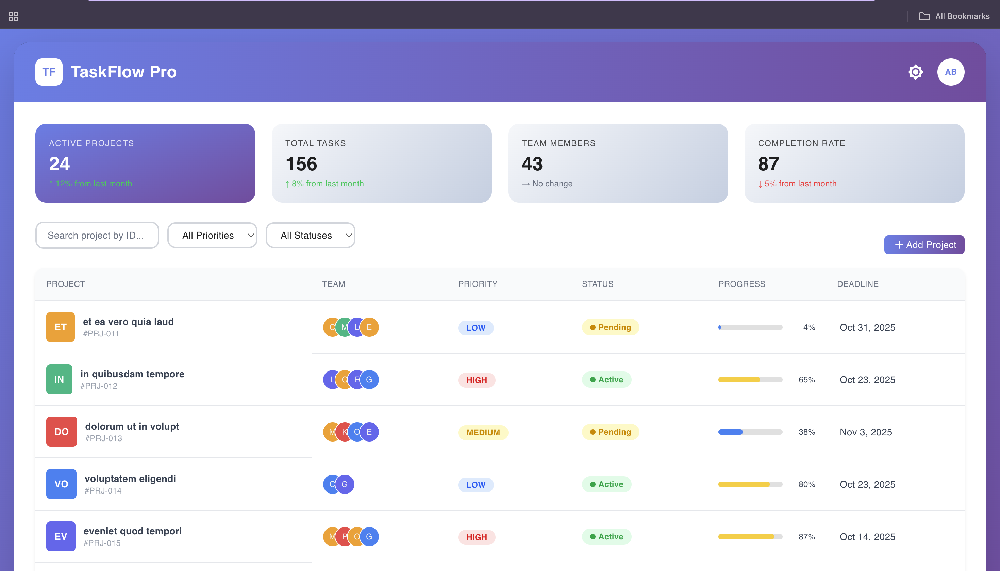

# Rival-IO Assessment: Project Dashboard

> A project management dashboard built as a front-end assessment for Rival.io, with React 19, TypeScript, MUI and Tailwind CSS.


## 📌 Overview

A project management dashboard where users can add, view, and track projects with details like title, description, deadline, priority, and team members.

Sample data is loaded from the public [JSONPlaceholder](https://jsonplaceholder.typicode.com/) API: users become team members and posts are transformed into projects. New projects are kept in React state for the session.

Live Demo: [Click Here](https://rival-io-assesment-aryanbhandari-88odi7fjw.vercel.app/)

### Dashboard View


---

## ✨ Features Implemented

- Add a new project with title, description, deadline, priority and team members, in a modal dialog
- Project listing in a responsive, paginated table with team avatars, status chips and a progress bar
- Search by project ID and filter by priority and status
- Project details drawer with status and a linear progress bar
- Light / dark theme toggle, saved in `localStorage`
- Deployed on Vercel

## 🛠 Tech Stack

| Area | Tools |
|---|---|
| Framework | React 19, TypeScript, Vite (SWC plugin) |
| UI | MUI 7 (Material UI + icons, Emotion), Tailwind CSS 4 |
| Data | JSONPlaceholder REST API (`/users`, `/posts`) |
| Tooling | ESLint, typescript-eslint |

## 📁 Project Structure

```
src/
├── App.tsx                         # theme provider + lazy-loaded Dashboard
├── context/ThemeContext.tsx        # light/dark mode, persisted to localStorage
├── pages/Dashboard.tsx
├── components/
│   ├── layout/                     # DashboardHeader (theme toggle), Theme
│   └── dashboard/
│       ├── DashboardContent.tsx
│       └── content/
│           ├── ContentTable.tsx    # data loading, filters, pagination, table
│           ├── ModalBox.tsx        # "add project" dialog
│           └── ProjectDrawer.tsx   # project details drawer
└── assets/                         # logo, color palette
```

## 🚀 How to Run the Project Locally

1. **Clone the repository**
   ```bash
   git clone https://github.com/aryanbha123/rival.io-assesment-aryanbhandari.git
   cd rival.io-assesment-aryanbhandari
   ```
2. **Install dependencies**
   ```bash
   npm install
   ```
3. **Start the development server**
   ```bash
   npm run dev
   ```
   Then open the URL Vite prints (by default http://localhost:5173).

Other scripts: `npm run build` (type-check and production build), `npm run preview`, `npm run lint`.

## Assumptions Made

- Node.js and npm are installed on the system.
- The app is primarily tested on modern browsers (Chrome, Firefox, Edge).
- An internet connection is required, since sample data comes from the JSONPlaceholder API.

## Author

**Aryan Bhandari**: [GitHub](https://github.com/aryanbha123)
